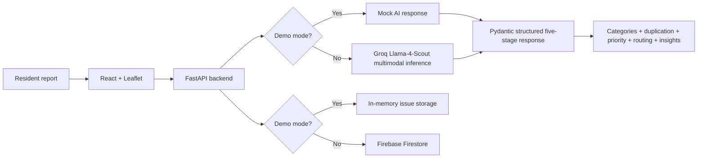

# CivicPulse — AI-Assisted Civic Issue Triage

[](https://github.com/Consoder/CivicPulse/actions/workflows/ci.yml)
[](https://github.com/Consoder/CivicPulse/actions/workflows/browser-smoke.yml)


> **Hackathon prototype** · FastAPI + React + Leaflet + Firebase · LLM-based civic issue triage

CivicPulse helps residents report civic issues and helps municipal teams categorize, prioritize and route reports. The proof of concept combines a React map interface, FastAPI APIs, Firebase integrations and a structured five-stage AI analysis response.

**Development status:** Source published for review and local reproduction. The repo does **not** establish a verified public/cloud production deployment.

**Verified 21 Nov 2026:** GitHub CI passed Python demo-mode API integration tests and the React production build. A separate clean-run Chromium browser test confirmed the React page renders, the report button is present and the API returns five demo issues without JavaScript page errors. **A public cloud deployment, real Groq calls and Firebase integrations remain unverified.** See [the verification report](docs/DEPLOYMENT_VERIFICATION.md).

## What is implemented

- **Issue classification / quality context:** classify reported issues using supplied images and text, with structured response models.
- **Duplicate indication:** compare reports against provided nearby issue records.
- **Priority scoring:** produce structured severity signals and recommendations.
- **Routing and briefing:** suggest departments and generate operational summaries.
- **Issue workflows:** FastAPI routers for issues, votes, users and AI analysis.
- **Mapping:** React + Leaflet visualization; Firebase Auth/Firestore integration paths.
- **Demo fallback:** `DEMO_MODE=true` serves mock AI responses and stores data in memory, without external API calls.

### Important technical clarification

The original design documents describe **Gemini 2.0 Flash and five agents**. The provided code currently invokes **Groq (Llama-4-Scout)** with one multimodal prompt that asks for **five structured reasoning stages**, then validates its response with Pydantic. **It is not five autonomous agents with separate LLM tool calls.** Local demo mode returns mock responses rather than running the live model. This README describes the code, not the earlier proposed architecture.

## Architecture



## Stack

| Layer | Technology |
|---|---|
| Web | React 18, Vite, Tailwind CSS, Zustand, React-Leaflet, Recharts |
| Backend | Python, FastAPI, Pydantic |
| AI (current source) | Groq API with Llama-4-Scout; structured JSON output / fallback |
| Data / Auth | Firebase/Firestore/Auth; in-memory demo mode |
| Developer tooling | Docker, Docker Compose, Cloud Build configuration |

## Quick start

**Requirements:** Python 3.12+, Node.js 20+ and npm.

1. Clone:

```bash
git clone https://github.com/Consoder/CivicPulse.git
cd CivicPulse
```

2. Backend in mock/demo mode:

```bash
cd backend
python -m venv .venv
# Windows: .venv\Scripts\activate
# macOS/Linux: source .venv/bin/activate
pip install -r requirements.txt
cp .env.example .env      # Windows: copy .env.example .env
uvicorn app.main:app --reload
```

Backend Swagger: `http://localhost:8000/docs`, health endpoint: `http://localhost:8000/health`.

3. Frontend (in a second terminal):

```bash
cd frontend
npm ci
cp .env.example .env.local   # Windows: copy .env.example .env.local
npm run dev
```

Visit `http://localhost:5173`. Firebase sign-in features require your own valid **Firebase Web App** configuration; placeholders are not functional credentials. In-memory demo backend mode does not require a live database.

## Original source files

- `backend/app/main.py` — FastAPI application and health endpoint
- `backend/app/routers/` — AI, issues, votes, users
- `backend/app/services/civic_intelligence_engine.py` — five-stage structured response and inference
- `backend/app/services/firebase_service.py` — Firebase or local demo data service
- `frontend/src/` — React screens, components, API clients, hooks, state
- `cloudbuild.yaml` — deployment preparation/configuration, not proof of a live deployment
- `architecture.md` and `brain.md` — original design/reference documents; may describe *planned* features

## Safety and limitations

- **No credentials committed.** The supplied archive contained `backend/.env`, `frontend/.env.local`, and `backend/serviceAccountKey.json`; these are intentionally excluded from this public source package. Rotate any exposed keys if they have been published elsewhere.
- Demo mode uses mock data and is **not** evidence of model inference quality or production readiness.
- AI classifications and priorities are decision-support outputs requiring human review.
- Cloud Run / Cloud Build configurations do not mean the application was deployed to a public endpoint.

## Maintainer

[Consoder](https://github.com/Consoder)
